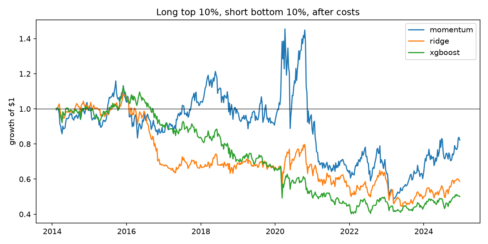
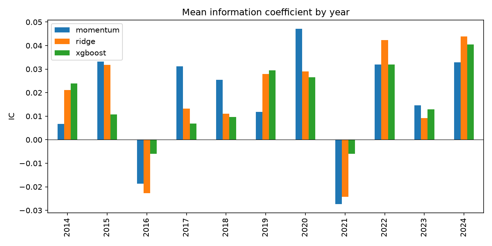

# Predicting weekly stock returns with machine learning

Every week, this ranks 112 large US stocks from "likely to do best next week" to "likely to do worst", and checks whether machine learning ranks them better than a simple momentum rule, once everything is tested on years the models never saw and trading costs are paid.

## What it does

Three ways of ranking the stocks are compared:

| Signal | What it is |
|---|---|
| Momentum (baseline) | Return over the last 12 months, skipping the most recent month. No model. |
| Ridge | Linear regression with an L2 penalty on 9 price and volume features. |
| XGBoost | Gradient-boosted trees on the same features, so it can pick up non-linear effects. |

If the models can't beat momentum, they aren't adding anything.

## Installing and running

```
conda env create -f environment.yml
conda activate equities-ml
python run.py               # real data, downloaded once and saved in data/
python run.py --synthetic   # fake data with a hidden signal, no internet needed
pytest
flake8 .
```

The tables are printed and saved in `results/` along with two figures.

## Method

**Data.** Daily prices and volumes from Yahoo Finance, 2010 to 2024, adjusted for splits and dividends.

**Features.** All of them use prices up to the close of the current day only:

| Feature | Meaning |
|---|---|
| `mom_12_1`, `mom_6_1` | Return from 12 (or 6) months ago to 1 month ago |
| `mom_1m` | Return over the last month |
| `rev_1w` | Return over the last week (big winners often fall back) |
| `vol_1m`, `vol_3m` | Volatility of daily returns over 1 and 3 months |
| `max_ret_1m` | Largest one-day return last month |
| `log_dvol` | Log of average money traded per day (size and liquidity) |
| `dist_52w_high` | How far the price is below its 52-week high |

Each feature is ranked across the stocks on each date and scaled to -0.5 to 0.5. The models then learn which stocks are better than the others that week, and outliers or market-wide crashes don't distort the features.

**Target.** The return from tomorrow's close to five days later. Starting a day late means the strategy never trades at the price it used to decide. The models learn the rank of this return.

**Testing on unseen years.** The models are trained on the first three years and predict the next year, then retrained with that year added, and so on. The last two training weeks are always left out (an embargo). Each target ends six trading days after its date, so the target of the week just before a test period isn't known until a day after that period starts. Training on it would use information from the future. One week is the minimum needed, and two gives a margin. The model settings are fixed in advance, not tuned on the test years.

**Scoring.**
- **Information coefficient (IC):** the Spearman correlation between predicted and real returns across stocks, each week. 0 is random. On large US stocks, even 0.02 to 0.05 is useful.
- **Long-short backtest:** each week, buy the top 10% of predictions and short the bottom 10%, equally weighted. Turnover is the total weight traded each week, so 4 would mean every stock was replaced. Trading costs are 10 basis points per unit of turnover. The Sharpe ratio is the annual return divided by the annual volatility, shown both before and after costs.

**Checking the pipeline.** `--synthetic` makes fake prices with a hidden signal. The models find it (IC about 0.09), and with the signal switched off the IC is close to 0, which shows the testing setup doesn't leak future information. Both checks are in the tests.

## Results

112 stocks, tested on February 2014 to December 2024 (2 tickers failed to download and were dropped).

| | Momentum | Ridge | XGBoost |
|---|---|---|---|
| Mean IC | 0.017 | 0.017 | 0.016 |
| IC t-stat | 1.51 | 1.79 | 2.40 |
| Weekly turnover | 0.55 | 2.31 | 2.34 |
| Sharpe before costs | 0.18 | 0.44 | 0.40 |
| Annual return after costs | 2.1% | -2.9% | -4.8% |
| Sharpe after costs | 0.08 | -0.14 | -0.28 |
| Max drawdown | -67% | -59% | -64% |





The models find a small signal but don't beat momentum on IC. All three are around 0.017, which is a weak but normal edge for large US stocks. XGBoost has the same average IC but it is steadier from week to week, so it is the only one with a t-stat above 2. Having tried three signals, I wouldn't read too much into that.

Before costs, Ridge and XGBoost have more than twice momentum's Sharpe (0.44 and 0.40 against 0.18), although over 11 years a Sharpe ratio is only known to about plus or minus 0.3, so this gap could be noise. After costs they lose money. Their predictions change a lot from week to week, so they trade about four times as much as momentum, and at 10 bps that is roughly 11 to 12% a year against about 3% for momentum. Whatever edge there is, it is too small to pay for weekly trading.

The IC is positive in 9 of the 11 years and negative for all three signals in 2016 and 2021, which suggests the models are picking up much the same effect as momentum. Momentum's big rise and crash in 2020 is the well-known momentum crash: 2020's winners reversed sharply in November.

With only about 11 stocks on each side, the long-short portfolios are noisy, which is why the drawdowns are so large.

## Limitations

- **Survivorship bias.** The stocks are today's large caps, so companies that failed or were removed from the index are missing. This flatters the results.
- **Small universe.** Large caps are heavily traded, so any edge is small. More stocks (for example the Russell 3000) would help.
- **Simple costs.** A flat cost ignores market impact and the cost of borrowing stocks to short.
- **Known factors.** Some of the profit may just be exposure to the market, size or sector. Regressing the returns on the Fama-French factors would show how much is left.
- **Turnover.** The obvious next step is trading less: rebalancing monthly, or smoothing the predictions over a few weeks, to keep the edge and cut the costs.
- **Reusing the test years.** Every new idea tried on the same history makes those years a little less unseen.

## Structure

```
run.py              runs everything, prints and saves the results
src/data.py         downloads prices, or makes synthetic ones
src/features.py     features, forward returns and the X / y table
src/models.py       Ridge, XGBoost and the walk-forward training
src/backtest.py     IC, long-short backtest and the summary table
tests/              pytest tests
```
